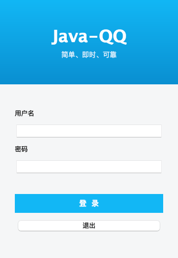
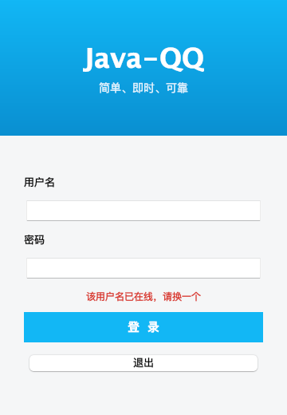

# Java-QQ Chat

一个基于 Java Socket + Swing 的局域网即时通讯程序。支持多客户端同时在线、点对点消息、群聊、文件传输，带完整的图形界面。

这是「Java 程序设计」课程的第三次实验作业，从一段只能「你说一句我回一句」的示例代码出发，重写成了一个可用的聊天工具。


## 功能

- **多客户端在线**：服务端为每个连接开一个线程，用户可同时在线互不干扰
- **点对点消息**：消息统一经服务端中转，客户端之间不直连
- **并行通信**：收发分离，发消息不会被对方的回复阻塞，连续发送也不卡
- **群聊**：一键发给全部在线用户
- **文件传输**：支持任意文件收发，最大 100MB
- **图形界面**：登录界面（含失败提示）、好友列表（实时在线状态）、QQ 风格聊天窗口
- **实时好友列表**：服务端广播上下线事件，列表自动更新

## 界面预览

| 登录界面 | 登录失败提示 |
|---|---|
|  |  |

| 好友列表 | 聊天窗口 |
|---|---|
|  |  |

## 快速开始

需要 JDK 8 或更高版本（开发和测试用的是 JDK 21）。

```bash
# 1. 编译
javac -encoding UTF-8 -d out src/*.java

# 2. 启动服务端
java -cp out Server 8888

# 3. 另开一个终端，启动客户端（可以开多个）
java -cp out QQClient 127.0.0.1 8888
```

客户端启动后输入用户名和密码登录，多开几个就能互相聊天了。

> 密码目前只做非空校验，没有接入真正的账号体系，见「已知限制」。

## 架构

```
┌──────────┐   ┌──────────┐   ┌──────────┐
│ Client A │   │ Client B │   │ Client C │
└────┬─────┘   └────┬─────┘   └────┬─────┘
     │              │              │
     └──────────────┼──────────────┘
                    │  TCP
             ┌──────▼───────┐
             │    Server     │
             │  在线用户表    │
             │  消息路由      │
             └──────────────┘
```

所有消息都经过服务端，服务端维护一张「用户名 → 连接」的在线表，收到消息后查到目标连接转发过去。

### 源码结构

| 文件 | 职责 |
|---|---|
| `src/Protocol.java` | 协议常量、读写工具，客户端服务端共用 |
| `src/Server.java` | 服务端：接受连接、维护在线表、消息路由、文件中转 |
| `src/Client.java` | 客户端通信层：连接、收发线程、消息回调 |
| `src/QQClient.java` | 主窗口：登录界面 + 好友列表 |
| `src/ChatWindow.java` | 聊天窗口：消息历史、输入、文件发送 |
| `src/legacy/` | 课程提供的原始示例代码，保留供对照 |

## 协议设计

采用纯文本行协议，一行一条命令，命令字和参数用空格分隔，消息正文放在最后：

**客户端 → 服务端**

```
LOGIN <用户名>                        登录
LIST                                  请求在线列表
MSG <目标用户> <内容>                  发送消息
GROUP <内容>                          群发
FILE <目标用户> <文件名> <字节数>       发文件（这行之后紧接原始字节）
LOGOUT                                退出
```

**服务端 → 客户端**

```
LOGIN_OK                              登录成功
LOGIN_FAIL <原因>                     登录失败
LIST <用户1>,<用户2>                   在线名单
MSG <发送者> <内容>                    收到消息
SYS <提示>                            系统提示
FILEIN <发送者> <文件名> <字节数>       文件即将到达
```

### 文件传输怎么做到不错位

文本和二进制混在同一个流里最容易出问题。做法是：先发一行声明文件名和字节数，接收端读到这一行之后就不再用 `readLine`，而是**精确读取指定字节数**，读满再回到正常读行的状态。

```
FILE 李四 test.txt 1024\n     ← 文本行
<1024 字节的原始二进制>        ← 紧接着的字节
```

只要发送端声称多少字节、实际就发多少字节，接收端就不会把后面的消息当成文件内容吃掉。

## 并发模型

原始示例代码的 `SingleTalkClient` 把发送和接收串在同一个循环里，发完必须等对方回复，否则卡住。本项目的做法是：

- **接收**：连接建立后单独起一个线程，一直阻塞在 `readLine()`，有消息就回调给界面
- **发送**：界面线程直接写 `PrintWriter`，不等待任何响应

这样发送和接收互不影响，连续发十条消息也不会互相等待。

## 测试

网络层有一套无界面的自动化测试，不需要图形环境：

```bash
# 终端 1：起服务端
javac -encoding UTF-8 -d out src/Protocol.java src/Server.java src/Client.java
java -cp out Server 18888

# 终端 2：跑测试
javac -encoding UTF-8 -d out -cp out tools/NetTest.java
java -cp out NetTest 18888
```

覆盖 9 个场景共 20 项断言：

```
=== 测试1：登录与在线列表 ===
  [通过] 张三登录成功
  [通过] 李四登录成功
  [通过] 李四的列表含张三
  [通过] 李四的列表含自己

=== 测试2：重名登录被拒绝 ===
  [通过] 重名登录返回 LOGIN_FAIL

=== 测试3：点对点消息经服务端中转 ===
  [通过] 李四收到消息
  [通过] 发送者正确
  [通过] 内容正确

=== 测试4：并行通信（连发不等回复）===
  [通过] 5 条全部送达

=== 测试5：群发 ===
  [通过] 李四收到群消息
  [通过] 王五收到群消息
  [通过] 张三自己不收到
  [通过] 群消息带 [群] 标记

=== 测试6：文件传输 张三 -> 李四 ===
  [通过] 李四收到文件
  [通过] 文件大小一致
  [通过] 文件内容一致

=== 测试7：下线后列表更新 ===
  [通过] 李四列表中已无王五

=== 测试8：给不在线的人发消息 ===
  [通过] 服务端回了系统提示

=== 测试9：长消息与特殊字符 ===
  [通过] 长消息送达
  [通过] 长消息内容完整

=========================================
  通过 20 项，失败 0 项
=========================================
```

`tools/` 下还有几个辅助脚本，用来把界面渲染成图片做像素级检查（`UiFlow.java`、`UiShot.java`、`PixelCheck.java`），在没有图形界面的环境里验证布局。

## 已知限制

- **没有持久化**：服务端在内存里维护在线表，重启后所有用户需要重新登录
- **没有离线消息**：对方不在线时消息直接丢弃，只回一句系统提示
- **密码未验证**：登录只检查非空和重名，没有真正的账号体系
- **不支持断线重连**：连接断了需要重启客户端
- **没有消息序号**：不做去重和排序保证

这些是真实 QQ 有而本项目没有的部分，也是后续可以继续做的地方。

## 踩过的坑

记录几个开发过程中真实遇到、并且值得写下来的问题：

1. **Swing 里做网络操作会卡死界面**。连接 Socket 是阻塞的，直接写在按钮事件里窗口会整个失去响应。必须放到后台线程，结果再 `SwingUtilities.invokeLater` 切回界面线程更新。
2. **文件传输用 `readLine` 读二进制会错位**。二进制数据里恰好出现换行符时会被当成一行结束，后面的消息全部错乱。必须按声明的字节数精确读取。
3. **同名用户会互相顶掉**。原先直接用 `Map.put`，后登录的会覆盖前一个的连接，前一个人还在发消息却收不到回复。改用 `putIfAbsent` 拦住重名登录。
4. **原始示例代码是 GBK 编码**。直接 `javac -encoding UTF-8` 编译会报「不可映射字符」，得用 `-encoding GBK`。自己新写的代码统一用 UTF-8。

## 许可

课程作业项目，仅作学习交流使用。
